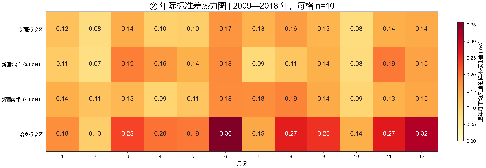

# ERA5 新疆风资源分析

使用 Python、xarray 和 Cartopy 分析 ERA5 10米风速，包含季节循环、相对与绝对阈值对照、风玫瑰、月份差值和显著性分析。

- [项目说明与已有结果](说明.md)
- [图集索引与读图说明](图集/说明.md)
- [研究进度日志](进度日志.md)
- [WRF 与 LPJ-GUESS 输入输出笔记](笔记/WRF与LPJ-GUESS输入输出.md)

## 近期成果（2026-11-04—11-06）

| 分析 | 图件与方法 | 复现脚本 |
|---|---|---|
| 相对 p95 与固定 10.8 m/s 阈值 | [结果说明](图集/阈值对照/结果说明.md) | [脚本](试验/相对与绝对阈值对照.py) |
| 2020年7月减1月的双色差值 | [说明](图集/双色差值/说明.md) | [脚本](试验/双色差值图.py) |
| 时间相关下的显著性打点 | [检验说明](图集/双色差值/显著性检验说明.md) | [脚本](试验/显著性打点.py) |
| 分布、季节循环、距平、风玫瑰和块长敏感性 | [五组图说明](图集/五组风资源分析/说明与结果.md) | [脚本](试验/五组风资源分析图.py) |
| 年际波动与月份配对显著性 | [四张图与方法](图集/年际波动与月份显著性/说明与结果.md) | [脚本](试验/年际波动与月份显著性.py) |




新增图件为600 DPI；提高导出清晰度不会提高ERA5原始空间分辨率。统计结果基于指定样本、区域掩膜和检验假设，助手计算交付与本人独立复现分开记录。

## 运行

建议使用已有 `met` 环境。`environment.yml` 为原Windows环境完整导出，跨平台安装时可只安装下列核心依赖：

```bash
conda create -n met -c conda-forge python=3.11 numpy scipy xarray matplotlib cartopy netcdf4 dask shapely pytest
conda activate met
python -m pip install -e . --no-deps
```

原始输入保留在本地，不上传仓库：

- `data/yearly/era5_2009.nc` 至 `era5_2018.nc`：完整六小时时次，包含 `u10`、`v10`。
- `data/era5_202001.nc` 与 `data/era5_202007.nc`：2020年1月、7月六小时数据。
- `data/admin/xinjiang_pref.json`：行政区边界；获取方式见 `2_程序/4_对比图_带行政区.py`，运行后确认边界文件存在。

完整重算按下列顺序执行；已提交小型派生NetCDF，因此最后一步也可直接用仓库中的区域统计重画，无需原始气象文件：

```bash
python 试验/相对与绝对阈值对照.py
python 试验/双色差值图.py
python 试验/显著性打点.py
python 试验/五组风资源分析图.py
python 试验/年际波动与月份显著性.py
```

## 统计口径

- 阈值对照以2009—2014年为基准、2015—2018年为研究期。
- 2020年月差检验使用日均样本、循环移动块重采样与BY多重比较校正；3/5/7天块长提供敏感性对照。
- 年际月份比较使用2009—2018年10个同年配对样本、1024种符号翻转，264个比较统一BY校正；依赖配对交换条件及年份间近似独立。
- 南北分组以43°N简化划分；区域平均与格点结果分别解释。年际标准差表示离散程度，不等同于显著性。
- 新增区域统计与旧图可能采用不同时间、空间范围，不能直接混用峰值月份或风速数值。

原始数据、凭据、个人求职材料和论文全文译本未纳入本次更新。
