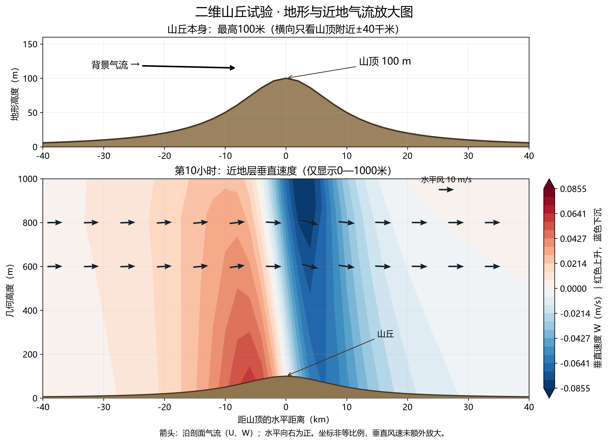
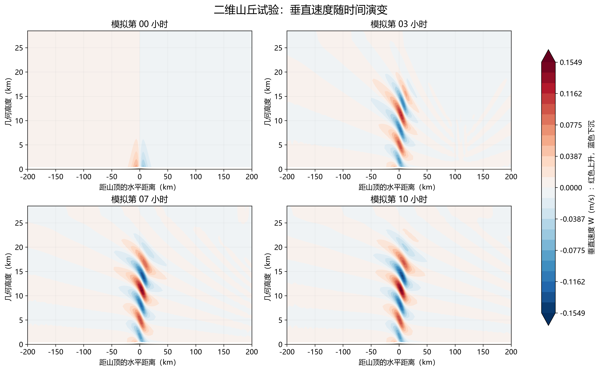

# 二维山丘案例编译与运行笔记｜2026-11-13

本笔记由助手按用户实际操作、终端成功标记和导出的数据整理。用户完成Ubuntu操作及结果导出；Python绘图由助手完成。没有记录实际学习分钟或认定本人独立绘图。

## 已完成结果

- 案例：em_hill2d_x，气流越过钟形山丘。WRF源目录版本沿用已有WRF 4.8.0；未额外从虚拟机读取版本头验证。
- GNU gfortran/gcc串行编译，no nesting。编译目录：~/WRF_BUILD/WRF_IDEAL。
- 初始化日志：SUCCESS COMPLETE IDEAL INIT；模拟日志：SUCCESS COMPLETE WRF。
- 实际读到11个输出时刻：模拟第0—10小时；水平网格间距2000米，质量网格201×2×40，山高100米。
- 本地数据：D:/work/自己跑的WRF/ideal试验/wrfout_hill2d.nc。

## 可复用操作清单

首次准备副本时从~/WRF_BUILD复制WRF为WRF_IDEAL；已有副本不要再次合并复制。下列清理命令仅用于需要重新编译时，确认当前目录是副本再运行。

```bash
cd ~/WRF_BUILD/WRF_IDEAL
cp configure.wrf configure.real.backup
./clean -a
export NETCDF="$(nc-config --prefix)"
export WRFIO_NCD_LARGE_FILE_SUPPORT=1
./configure
```

配置菜单选择GNU (gfortran/gcc)的serial（本次编号32），嵌套选0。配置成功后：

```bash
./compile -j 2 em_hill2d_x > compile-hill.log 2>&1
ls -lh main/ideal.exe main/wrf.exe
tail -n 25 compile-hill.log
```

应确认两个程序生成，编译日志无阻断错误。-j 2表示两个编译进程，与模型串行运行不矛盾。本次未记录编译总耗时。

程序已编译成功时，后续通常从这里开始；初次运行或确认输出已备份后再重复执行，避免旧结果被覆盖：

```bash
cd ~/WRF_BUILD/WRF_IDEAL/test/em_hill2d_x
./ideal.exe > ideal.console.log 2>&1
tail -n 25 ideal.console.log
ls -lh wrfinput_d01
# 确认SUCCESS COMPLETE IDEAL INIT后再运行：
./wrf.exe > wrf.console.log 2>&1
tail -n 25 wrf.console.log
ls -lh wrfout_d01_*
```

本案例串行运行，不使用mpirun。修改已有案例支持的运行参数或初始廓线，通常只需重新初始化和运行；切换初始化案例类型或改源代码才需要相应重新编译。ideal.exe是工具，wrfinput_d01是生成的初始场数据。

## 本次参数与文件

|参数|本次值及作用|
|---|---|
|run_hours|10，模拟10小时|
|time_step|20秒，时间积分步长|
|history_interval|60分钟，逐小时输出|
|frames_per_outfile|1000，允许多个时刻放在同一文件，所以一个wrfout内包含11帧|
|dx、dy|2000米|
|e_we/e_sn/e_vert|202/3/41；交错网格端点设置不等于质量网格维度|
|ztop|30000米，名义模式顶；图中质量层中心高度低于接口顶|
|物理方案|该配置关闭微物理、辐射、陆面、边界层及积云参数化，适合简化动力试验|
|边界|x方向开放、y方向周期|
|input_sounding|初始垂直廓线|
|namelist.input|运行时设置|

公元0001年的时间是理想化试验标签，不是真实天气日期。该案例不需要WPS、GFS和真实地形资料。

## 下载与绘图

Linux输出名含冒号，Windows不支持。先在Ubuntu复制改名再用FinalShell下载：

```bash
cp wrfout_d01_0001-01-01_00:00:00 wrfout_hill2d.nc
```

将数据放到脚本同一目录，使用包含numpy、matplotlib、netCDF4的Python环境：

```bash
python plot_hill.py
python plot_hill_zoom.py
```

plot_hill.py生成全域演变图和末时刻剖面；plot_hill_zoom.py生成带风向箭头的近地层图。03号无箭头图为早期版本保留，当前zoom脚本输出04号图。

高度=(PH+PHB)/9.81；位温=T+300 K。U沿x去交错，W与位势高度沿垂直去交错后可与质量层配对。全域图取中间y行；近地层填色使用原始接口W与接口高度，箭头使用同位置插值后的U/W。箭头U换算为km/s以匹配横轴千米，垂直方向保持m/s，按非等比例坐标显示，没有额外放大W。

山仅高100米，而全域高度约28千米，因此全域图中山不明显。局部图展示山顶±40千米、近地面0—1000米，另设地形面板；原山高不变。红色为上升，蓝色为下沉；风主要从左向右，近地迎风侧上升、背风侧下沉。此为理想化数值试验，不作为真实地区预报准确性验证。

## 读图与复现入口





仓库包含代码、namelist.input、input_sounding、PNG/PDF和小型数据核对记录。原始wrfout_hill2d.nc保留本地；仅有源码、配置不能直接执行绘图，需先运行WRF生成同名结果。

官方说明：https://www2.mmm.ucar.edu/wrf/users/wrf_users_guide/build/html/idealized.html

## 本次遇到的问题

- shell出现续行提示符“>”：曾误输入fi~，取消后正确输入fi。
- 缺少rpc/types.h的移动嵌套警告：本次不使用移动嵌套，后续初始化与运行成功。
- Windows下载失败：输出文件名含冒号，Linux侧先复制为wrfout_hill2d.nc。
- Python绘图进程无输出退出：在Windows进程中补入现有met环境Library/bin路径后成功。

## 今日收尾

编译笔记、过程日志和绘图交付已由助手整理。未据此认定用户独立撰写笔记或自动打卡；不追加新学习任务，不将昨日未确认事项滚成欠账。
