# 图集

31 张图里挑出 **13 张有结论的**，每张写清四件事：画的是什么、用什么数据、怎么读、结论是什么（以及局限）。

判断标准很简单：**随便点开一张，不问我，也能看懂它在说什么。**

> 所有图的代码都在 `2_程序/`，数据与处理链路见文末「数据说明」。

---

## 目录

| # | 图 | 一句话结论 |
|---|---|---|
| 1 | 2015 年平均风速（全要素） | 全区平均 3–5 m/s，哈密一带最高 |
| 2 | 2020 代表月四联图 | 四个月均值 2.34–2.85 m/s，7 月最大 |
| 3 | 2020 代表月平均 | 2.65 m/s，**不是真年均** |
| 4 | 2020-01 月平均 | 单月形态：西部与东部强、中部弱 |
| 5 | 2020-01 单点时间序列 | 单点 6 小时序列，均值约 2.3 m/s |
| 6 | CMFD 季节对比三联图 | 1 月 vs 7 月 vs 差值，附地州边界 |
| 7 | CMFD 12 月气候态 | **春峰冬谷**，全区峰值在 4 月 |
| 8 | CMFD 40 年年均序列 | 1979→1998 下降、1998→2018 回升 |
| 9 | 极端阈值 p95 | 逐格点阈值 0.49–12.82 m/s，空间差 20 倍 |
| 10 | 极端超阈天数 | 4 年累计 71 天，折合每年约 18 天 |
| 11 | 极端平均强度 | 平均超出 1.09 m/s，最大 3.02 |
| 12 | 极端最长持续 | 最长 5 个时次 = 30 小时 |
| 13 | 极端逐年趋势 | −0.15 天/年，**p=0.33 不显著** |

---

## 1. 2015 年平均风速（全要素）

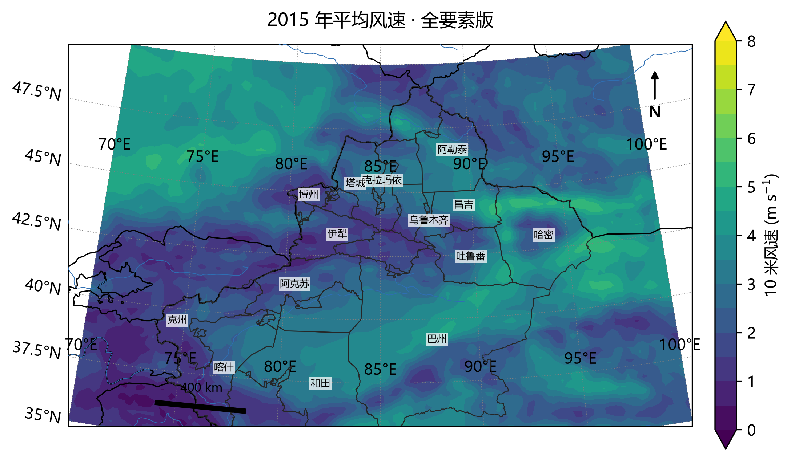

- **画的是什么**：2015 年全年平均的 10 米风速，叠加河流、14 个地州名、比例尺与指北针。
- **数据**：ERA5 单层，0.25°（61×121），6 小时，1460 个时次。
- **怎么读**：颜色是风速（0–8 m/s，viridis）；深紫是静风区，黄绿是强风区。**兰勃特投影**——新疆跨 30 个经度，等经纬度会把东西向拉长。
- **结论**：深紫（2–3 m/s）沿天山中段与塔里木盆地南缘；青绿（4–5 m/s）在准噶尔西部、哈密一带。河流基本沿天山南北两侧走，说明**地形控制风速**。
- **局限**：单年，不能代表 10 年平均；10 米高度不是轮毂高度。

## 2. 2020 年代表月四联图

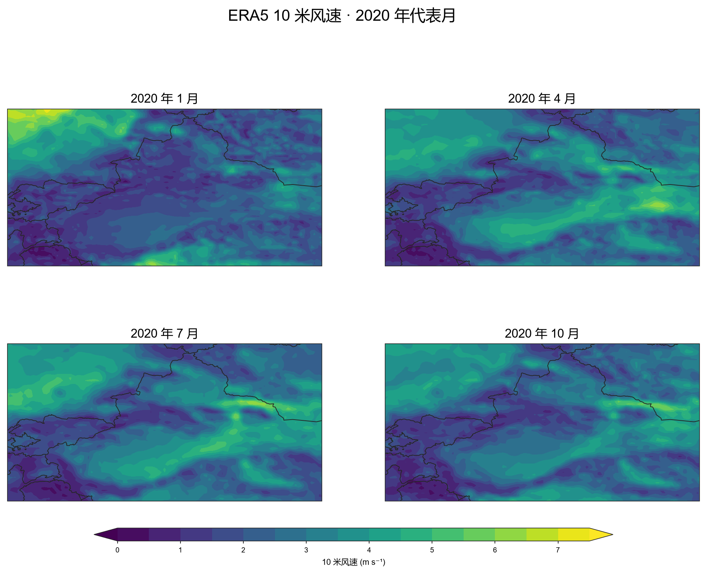

- **画的是什么**：2020 年 1/4/7/10 月的平均风速，2×2 排列。
- **数据**：四个月共 492 个时次，同网格。
- **怎么读**：**四张子图共用一套色标（0–7.5 m/s）**，所以颜色可以横向比。如果各自归一化，10 月的 5.98 m/s 会被画成和 1 月 7.16 一样的深色——结论就错了。
- **结论**：全区均值 1 月 2.34 / 4 月 2.78 / 7 月 2.85 / 10 月 2.62 m/s；最大值 1 月 7.16。**7 月略强，但四个月差不到 0.5 m/s。**
- **局限**：只有四个月，不能代表全年；四个月的"平均"也不等于年均。

## 3. 2020 代表月平均（不是年均）

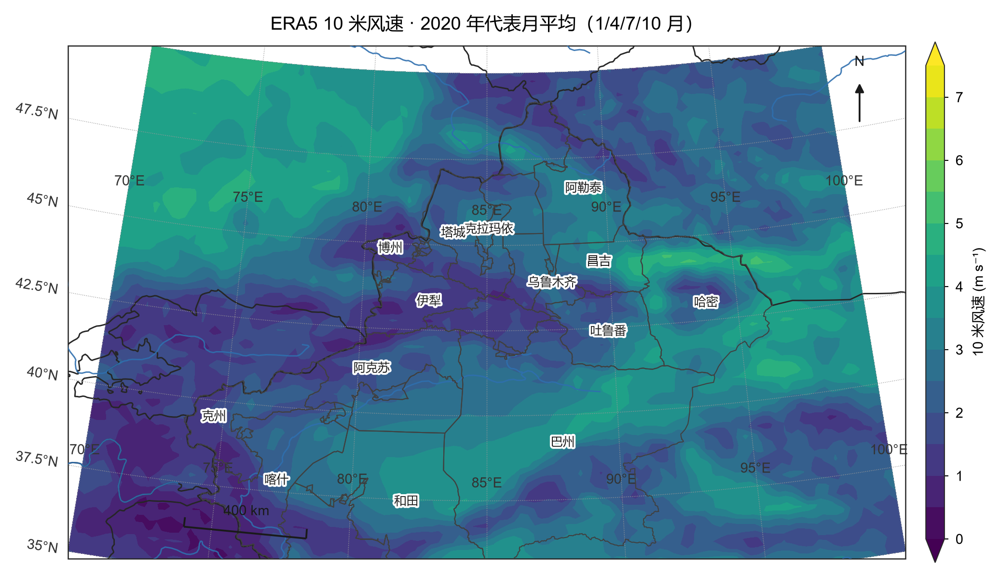

- **画的是什么**：把第 2 张图四个场再平均一次，得到一张图。
- **怎么读**：全区 2.65 m/s，最大 5.13 m/s。
- **结论**：这张图代表**四个代表月的合成**，不是 2020 年真年均——缺了 8 个月。
- **局限**：真年均要 12 个月，或按天数加权。图上标题与脚本注释都写了这一点。

## 4. 2020 年 1 月月平均

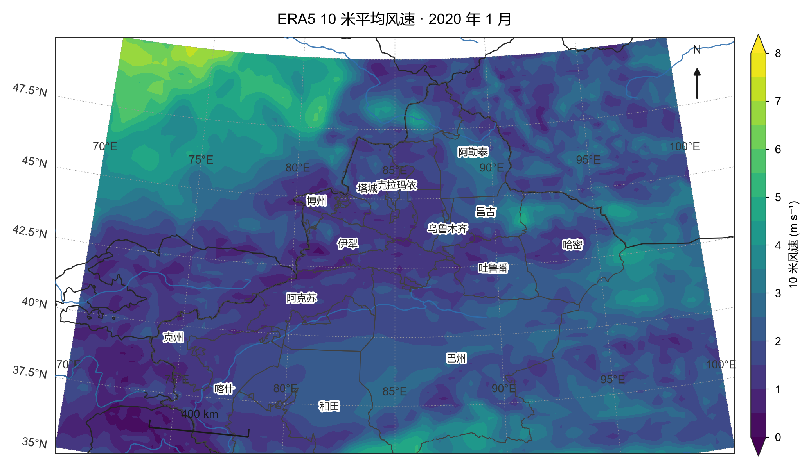

- **画的是什么**：单月（2020-01）平均风速，最基础的一张填色图。
- **怎么读**：西部（伊犁、塔城）与东部（哈密）偏强，中部天山一带偏弱。
- **结论**：单月也能看出"两强一弱"的空间格局，与第 1 张的多年平均形态一致。
- **局限**：单月代表性有限；10 米高度。

## 5. 乌鲁木齐单点时间序列

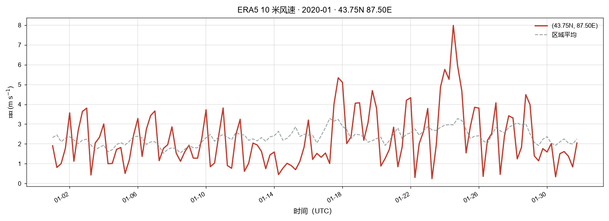

- **画的是什么**：43.8°N/87.6°E 附近（吸附到 43.75N、87.50E）2020 年 1 月的 6 小时风速，叠加区域平均作参照。
- **怎么读**：红色是单点，灰色虚线是全区平均。纵轴 m/s，横轴 UTC。
- **结论**：单点均值约 2.3 m/s，峰值接近 8 m/s；区域平均平稳得多——**单点波动远大于区域平均**。
- **局限**：6 小时分辨率不能谈"日变化"；时间是 UTC，北京时间为 +8。

## 6. CMFD 1 月 / 7 月 / 差值三联图

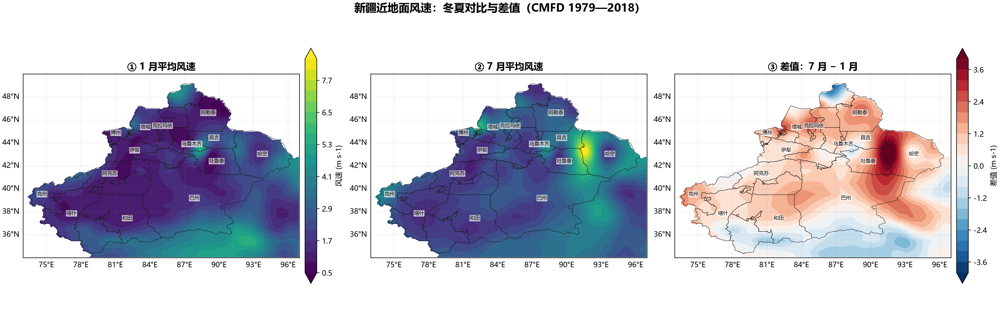

- **画的是什么**：1979—2018 年 CMFD 的 1 月平均、7 月平均，以及"7 月 − 1 月"的差值，叠加新疆地州边界。
- **数据**：CMFD 0.1°，40 年月平均。
- **怎么读**：差值图用发散色标，0 居中；红 = 夏季更大，蓝 = 冬季更大。
- **结论**：大部分区域 7 月风速高于 1 月（红），但**天山与部分盆地出现蓝区**——说明季节差异有区域反转。
- **局限**：只比两个月；后续用 12 个月排开后发现结论要修正（见第 7 张）。

## 7. CMFD 12 个月气候态（春峰冬谷）

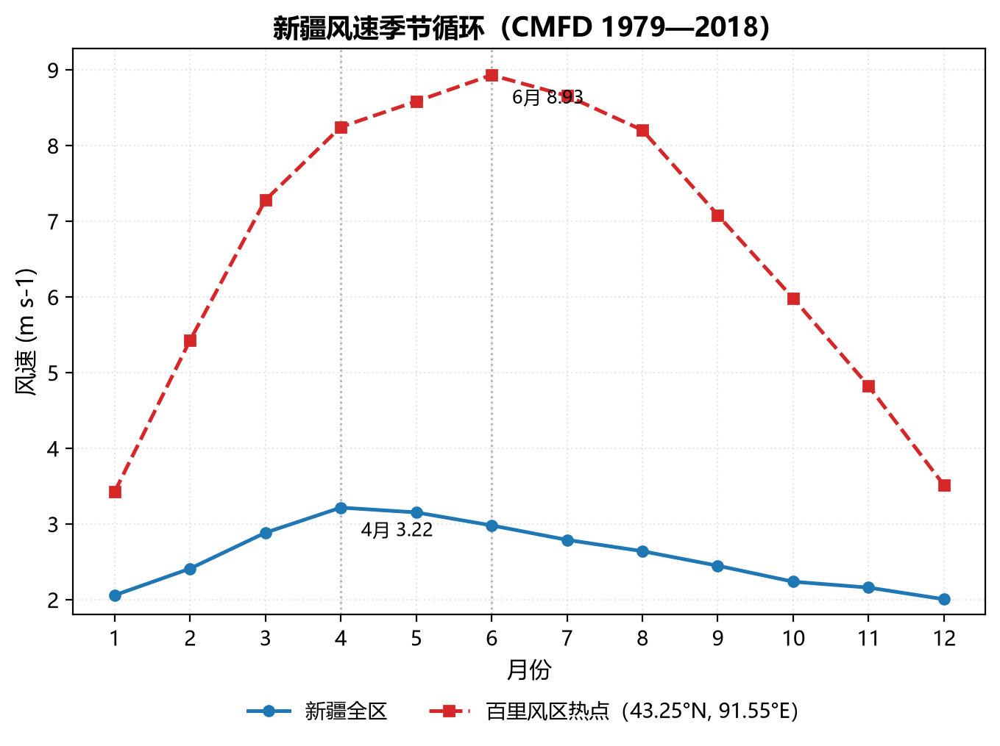

- **画的是什么**：全区与"百里风区热点"的 12 个月气候态曲线。
- **怎么读**：横轴月份，纵轴风速；两条线分别是全区平均与热点。
- **结论**（本图集最重要的一条）：**全区峰值在 4 月 3.22 m/s，谷值在 12 月 2.01**；而热点峰值在 **6 月 8.93**、谷值 1 月 3.42。两者峰值相差两个月。
- **局限 / 教训**：最初只比 1 月与 7 月，得出"夏峰冬谷"的结论——**用两三个时次做对比，容易把样本偏差当成物理规律**。这张图就是修正后的结果。

## 8. CMFD 40 年年平均序列

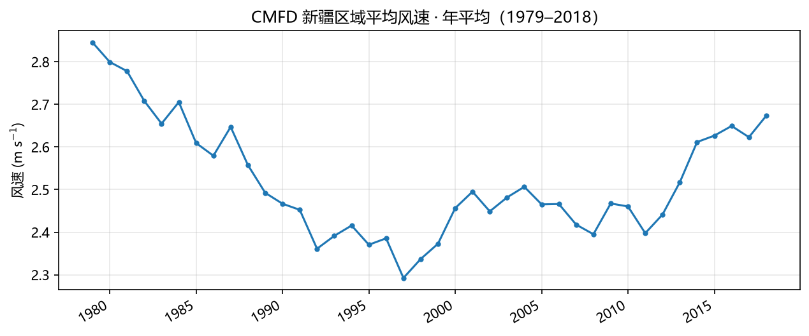

- **画的是什么**：1979—2018 年新疆区域平均风速的年平均序列。
- **怎么读**：点线是逐年值，纵轴 m/s。
- **结论**：**1979 年 2.85 → 1998 年 2.30（最低）→ 2018 年 2.67**，40 年先降后升，降幅 0.55、回升 0.37。
- **局限**：区域平均掩盖空间差异；未做趋势显著性检验。

## 9. 极端阈值（p95，逐格点）

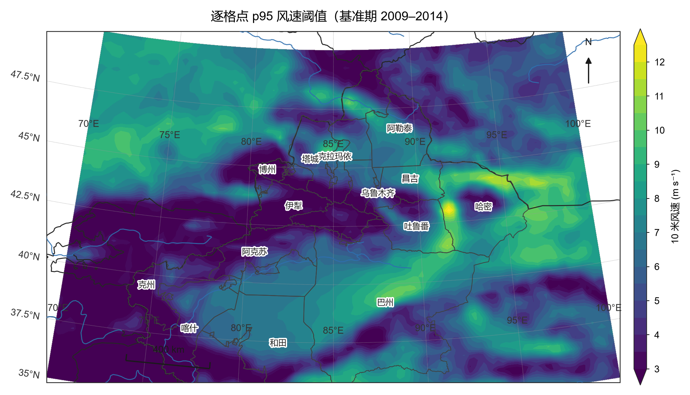

- **画的是什么**：基准期 2009—2014 年，每个格点自己 95 分位上的风速阈值。
- **数据**：ERA5 10 年数据（2009–2018），基准期约 2.1 万个时次。
- **怎么读**：阈值空间差 **0.49–12.82 m/s**（20 倍）；山区高、盆地低。**这说明不能用单一数字卡全疆**——3.58 m/s 对哈密太低、对塔里木太高。
- **结论**：阈值必须先按格点算，"全区统一阈值"只能回答"哪里风大"，回答不了"哪里异常"。

## 10. 极端超阈天数（研究期）

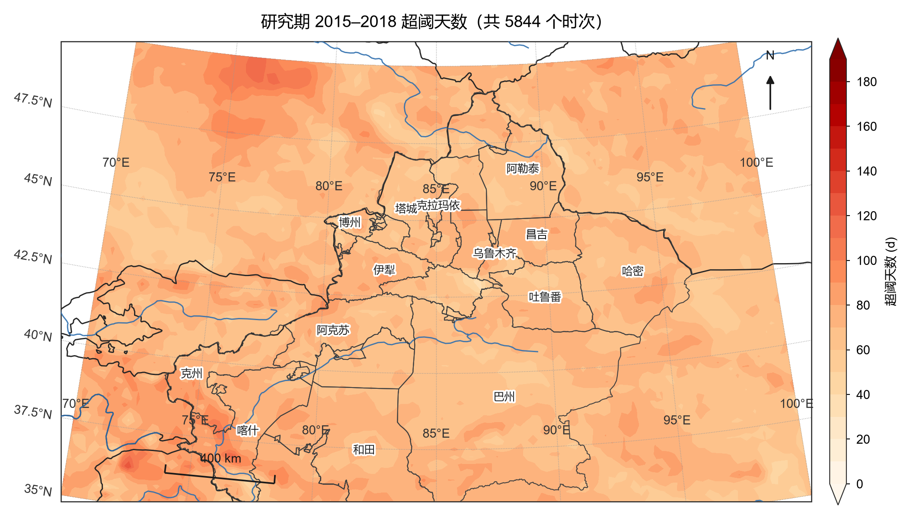

- **画的是什么**：研究期 2015—2018 年，各格点超过自己阈值的累计天数。
- **怎么读**：**4 年累计**，不是每年；区域均值 71.1 天、最大 129.8 天（折合每年约 18 天）。
- **结论**：因为阈值是逐格点的 p95，超阈率天然接近 5%——**这张图只能回答"哪里更异常"，不能回答"哪里风最大"**。这是方法本身的属性，不是数据巧合。

## 11. 极端平均强度

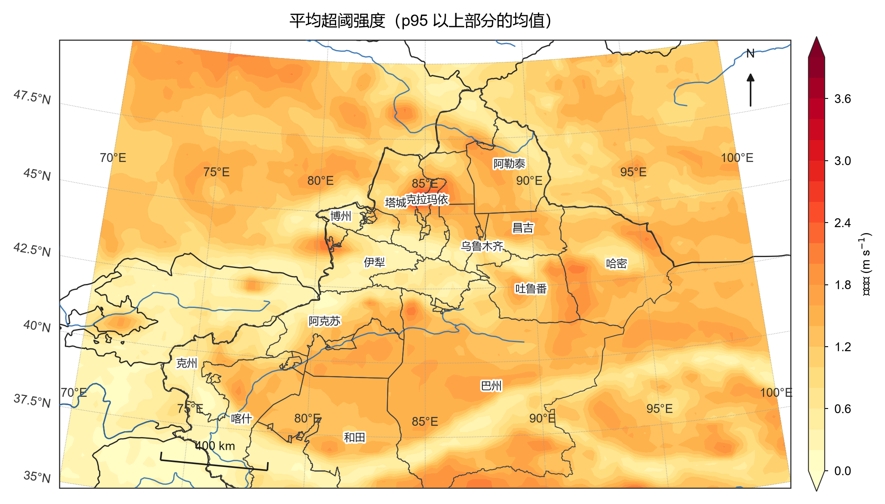

- **画的是什么**：超阈时刻的平均超出量（只对超阈的时刻求平均，不超的不参与）。
- **怎么读**：平均 1.09 m/s，最大 3.02 m/s。
- **结论**：强度高值区集中在天山与东部——这些地方一旦"超阈"，超得更多。
- **局限**：只统计超出量，不含频次信息；两者要一起看。

## 12. 极端最长持续

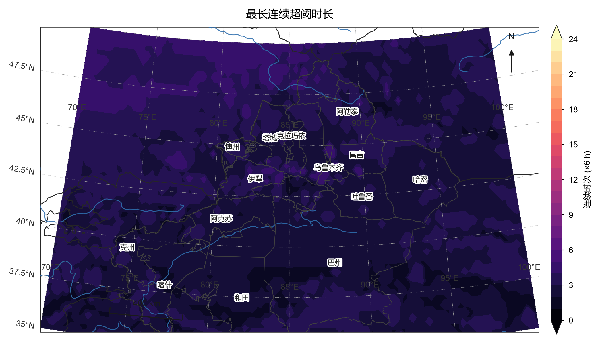

- **画的是什么**：连续超阈的最长时次（×6 小时）。
- **怎么读**：区域最长 5 个时次 = **30 小时**。
- **结论**：新疆的极端风过程持续时间短（1–2 天量级），与"冷空气过境"的物理图像一致。
- **局限**：6 小时分辨率会低估短过程；若用逐小时数据，最大值可能更高。

## 13. 极端逐年趋势

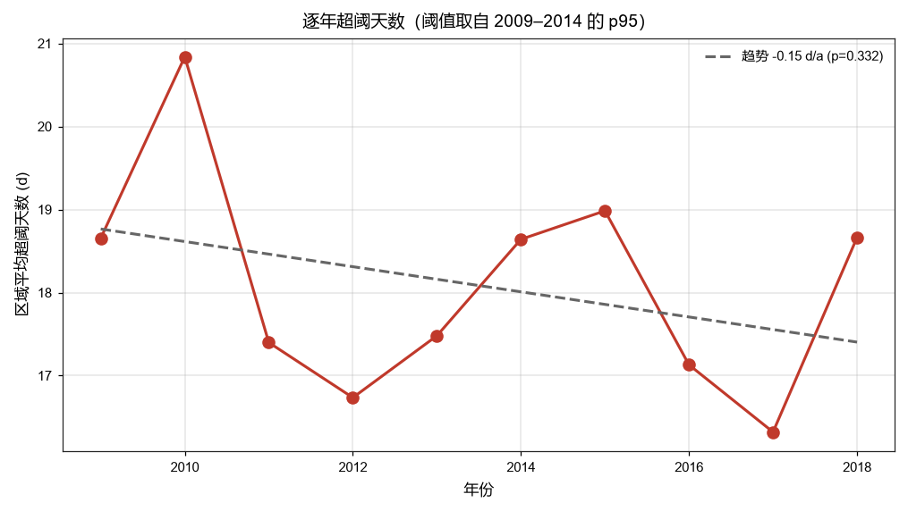

- **画的是什么**：用同一套阈值回算每一年，得到"区域平均超阈天数"的年际序列，附线性拟合。
- **怎么读**：纵轴是每年超阈天数（约 17–21 天），虚线是趋势。
- **结论**：**−0.15 天/年，p = 0.33，不显著**。10 年看不出风极端在变多或变少。
- **局限**：**p 不显著 ≠ 没有变化**。10 年对气候趋势太短，20–30 年才有统计意义。

---

## 不在图集里的图（调试 / 演示产物）

| 图 | 为什么排除 |
|---|---|
| `wind_demo.png` | 演示数据，只为验证环境能出图 |
| `cli_*.png`（6 张） | CLI 功能验证，内容与图集重复 |
| `投影_等经纬度/墨卡托.png`、`投影_三合一对比.png` | 方法论演示（"选错投影会怎样"），不是研究结论 |
| `要素_全要素_plate.png` | 与第 1 张同数据，只换投影，用于对比 |
| `试验_*.png`（2 张） | 早期用 4 个月数据做的阈值练习，样本不足 |
| `CMFD风速_1979-2018.png`、`-01月.png`、`-07月.png` | 与第 6 张重复（三联图已包含 1 月/7 月） |

## 数据说明

| 数据集 | 分辨率 | 时段 | 用途 |
|---|---|---|---|
| ERA5 单层（ARCO 版） | 0.25°，6 小时 | 2009–2018 | 极端指数（第 9–13 张） |
| ERA5 单层 | 0.25°，6 小时 | 2020 年 1/4/7/10 月 | 季节对比（第 1–5 张用 2015 或 2020） |
| CMFD | 0.1°，月平均 | 1979–2018 | 长期气候态（第 6–8 张） |

**统一处理**：所有图都走 `src/era5x/` 三层——`io` 统一坐标（valid_time→time、删 expver、纬度升序）、`compute` 算物理量、`plot` 出图。投影默认兰勃特，要素默认全开。

## 复现

```powershell
conda activate met
era5x plot --file data/yearly/era5_2015.nc            # 第 1 张
python 2_程序/8_画图_ERA5四季与年平均.py               # 第 2–3 张
python 2_程序/11_极端指数_正式.py                     # 第 9–13 张
```

每张图的具体参数见对应脚本开头的 docstring。
