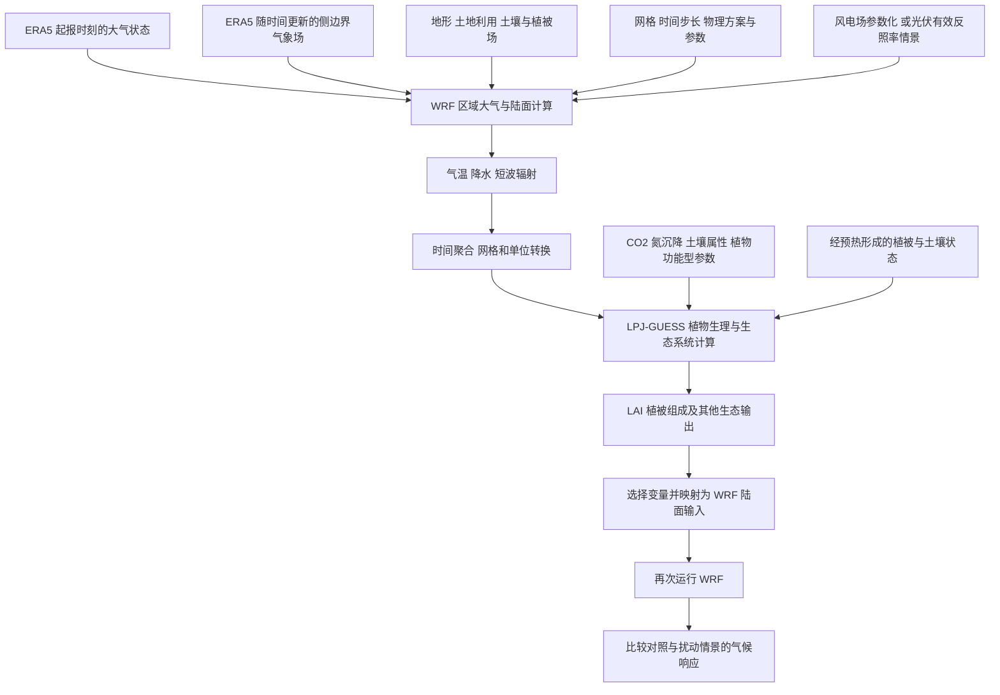

# WRF 与 LPJ-GUESS 输入输出

整理日期为 2026-11-05。本笔记由助手根据本地 Liu 与 Xie 中文翻译与阅读要点整理，用于今天的模型输入输出任务。下面的流程图是教学概括。论文特有的交换变量以各自方法和补充材料为准。

## 总体流程

## 三类输入怎么区分

| 类型 | WRF 示例 | LPJ-GUESS 示例 |
|---|---|---|
| 初始状态 | 起报时刻各格点的风 温度 水汽及陆面状态 | 初始植被组成 生物量 土壤水分和碳库 |
| 外部驱动或边界条件 | 随时间变化的区域侧边界场 太阳辐射强迫等 | 气温 降水 辐射 CO2 氮沉降 |
| 配置与过程参数 | 网格与时间步长 微物理 辐射 边界层 陆面方案 风机参数或光伏情景 | 植物功能型及其生理参数 土壤属性 扰动设置 |

初始状态描述开始时系统是什么样。外部驱动描述模拟过程中施加的条件。过程参数决定各过程如何计算。某个量属于哪一类，取决于它在具体模型接口中的用途。

植被反馈主要通过陆面输入进入下一轮 WRF。ERA5 提供的大气侧边界和植被反馈提供的陆面信息应分别识别。

## 模型内部如何一步步计算

WRF 将大气划分为三维格点，数值求解运动和热力等方程，并通过物理参数化计算辐射 云降水 湍流及陆面交换。每一步都利用当前状态与驱动算出变化量，再得到下一时刻的状态。

教学表达式为

    下一时刻状态 ≈ 当前状态 + 时间步长 × 当前变化率

这是帮助理解时间推进的简化式。WRF 实际采用更复杂的离散与积分算法。

LPJ-GUESS 根据气象与土壤条件计算光合作用 呼吸 水分收支等过程，再更新植物生长 竞争 建立和死亡，以及土壤碳等状态。不同过程可采用不同时间尺度。模型通常需要预热，让植被与土壤状态适应气候背景。

## 两篇论文实际怎样交换数据

| 环节 | Liu 新疆风电材料 | Xie 塔克拉玛干光伏材料 |
|---|---|---|
| WRF 气象输入 | ERA5 初始场与边界场 | ERA5 初始场与边界场 |
| 外部扰动 | 风电场参数化，包含风机位置和气动特征等 | 通过有效反照率表示光伏的地表能量扰动 |
| WRF → LPJ-GUESS | 逐日气温 降水 太阳辐射，结合 CO2 氮沉降和土壤类型 | 将六小时气温 降水 短波辐射做尺度转换，结合氮沉降与土壤质地等输入 |
| LPJ-GUESS → WRF | 将生态输出转换成下一轮 WRF 地表输入，具体变量清单需查原文表 S1 | 本地译文列出地表反照率 LAI 吸收光合有效辐射比例 土壤温度 土地利用等 |
| 特殊处理 | CTRL 与 WF 成对比较 | 反馈阶段仅更新非光伏覆盖区植被参数，光伏网格沿用基准地表条件 |

Xie 的有效反照率包含直接反射以及转为电能而离开局地加热过程的部分，因此解释这一情景参数时要保留其能量收支含义。

## 分阶段离线耦合

1. 运行基准 WRF1，气象输出驱动 LPJG1，得到基准植被条件。
2. 使用基准植被条件运行 WRF2 的对照与扰动情景，比较气象响应。
3. 将 WRF2 各情景的气象分别输入 LPJG2，比较植被响应。
4. 将 LPJG2 的指定输出处理后更新对应情景的 WRF 陆面信息，再运行 WRF3，评估包含植被反馈的气候响应。

中间需要完成时间尺度 网格 单位和植被类型映射，并检查缺测。双向表示信息既从气候传到植被，也从植被返回气候。离线表示按阶段传递数据并分轮运行。

比较时应保持对照与扰动的计算条件一致。可以先计算 WRF2 的“扰动减对照”，再计算 WRF3 的“扰动减对照”，比较两阶段的响应差异。具体效应分解须依照论文定义，植被反馈可能与原扰动发生非线性交互。

## 可直接口述的版本

我理解这两个工具都是过程驱动的数值模型。WRF 接收初始大气状态 随时间变化的边界场和地表信息，逐步计算风 温度 水汽与降水。气象输出经格式和尺度转换后驱动 LPJ-GUESS，模型据此计算植被生长和土壤状态。研究者再把指定的生态变量转换为 WRF 的陆面输入，重新运行 WRF，比较有无风光开发时的气候响应。这样可以分别研究开发对气候的影响 气候对植被的影响，以及植被变化对气候的反馈。

## 材料依据与核验范围

- D:/work/job/Liu_2026_新疆大型风电场论文中文翻译与阅读要点.docx，方法 2.3 与图 1(c)，提供四步运行顺序，气象驱动变量来自模型方法段落。
- D:/work/job/Xie_2026_塔克拉玛干沙漠光伏论文中文翻译与阅读要点.docx，方法 2.2.1—2.2.3，提供尺度转换 反馈变量与反馈区域限制。
- 本次读取的是本地中文整理材料，尚未逐项对照英文原文与补充材料。Liu 表 S1 的精确变量清单，以及 Xie 各变量的映射实现，仍应查原文或代码。
- 图和文字由助手整理完成。个人独立口述验收待本人完成。
